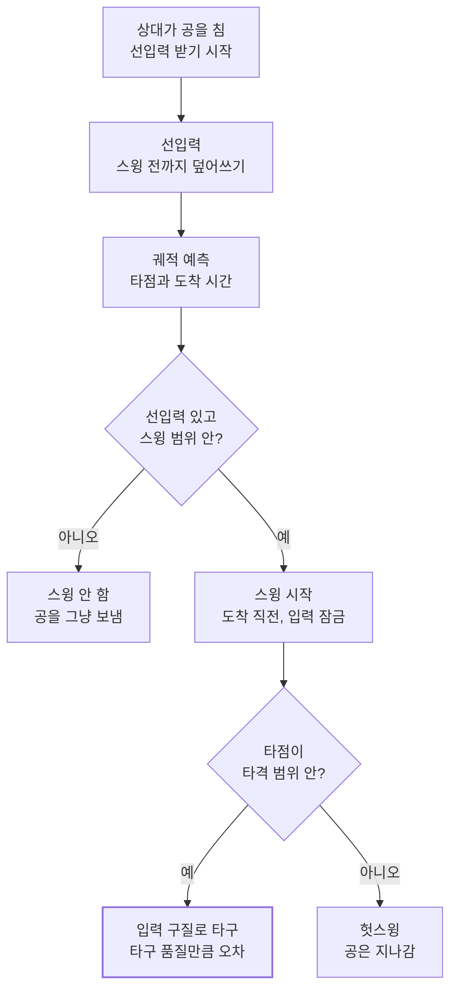
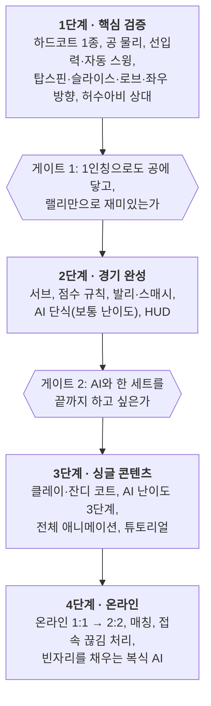

# 3D 테니스 게임 기획서 (수정본)

2026-10-13 기준

## 개요

1인칭 3D 테니스 게임이다. 플레이어는 위치를 잡고 공이 오기 전에 마우스 드래그로 구질을 미리 입력하며, 스윙은 공이 타격 범위에 들어오는 순간 자동으로 실행된다.

- 핵심 재미: 위치 선정과 구질 선택의 수 싸움. 스윙 타이밍은 시스템이 맞춘다
- 규칙: 실제 테니스 규칙(ITF)을 따르고, 경기 길이만 옵션으로 줄인다
- 플랫폼: PC (키보드 + 마우스)

| 모드 | 인원 | 형식 |
| --- | --- | --- |
| 싱글 | 1명 vs AI | 단식 |
| 멀티 1:1 | 2명, 온라인 | 단식 |
| 멀티 2:2 | 4명, 온라인 | 복식 |

마우스가 하나라 한 PC에서 두 명 이상 조작할 수 없으므로 멀티는 온라인 전용이다. 원안 대비 주요 변경점은 선입력 시작 시점, 이동 기준, 타격 범위 3단계, 범실 요소, 서브 조작, 발리 판정 방식이다. 문서의 수치는 모두 플레이테스트로 조정할 초기값이다.

## 시점과 카메라

카메라는 캐릭터 머리에서 공을 부드럽게 따라가고, 몸 방향과 이동 방향은 카메라와 분리한다. 1인칭은 공과의 앞뒤 거리를 판단하기 가장 어려운 시점이라, 위치 선정이 핵심인 이 게임에서는 거리감 보조가 필수다.

### 카메라 규칙

- 위치: 머리 본에 고정, 공을 향해 회전
- 몸 방향: 항상 네트를 향한다. 공을 따라 도는 건 머리(목)뿐
- 멀미 방지: 회전 속도 상한과 스무딩을 둔다. 머리 위로 넘어가는 로브처럼 크게 돌아야 할 때는 더 천천히 돈다
- 시야각(FOV): 기본 90°, 설정에서 조절

### 거리감 보조

보조 장치의 양으로 위치 잡기 난이도를 조절한다. 모니터는 입체감이 없어서 공 그림자와 낙하 지점 마커가 사실상 필수다.

| 요소 | 내용 | 보조 많음 | 보조 보통 | 보조 최소 |
| --- | --- | --- | --- | --- |
| 공 그림자 | 공 바로 아래 진한 그림자 | O | O | O |
| 낙하 지점 마커 | 상대 공이 떨어질 자리 표시 | O | O | — |
| 타격 범위 알림 | 공이 타격 범위에 들어오면 공 테두리 강조 + 효과음 | O | O | — |
| 타격 범위 링 | 바닥에 내 타격 범위 표시 | O | — | — |
| 위치 보정 | 공이 가까워지면 이상적 타점 쪽으로 몸을 살짝 끌어당김 | O | — | — |
| 자동 기본 스트로크 | 선입력이 없으면 탑스핀 스트로크를 중앙으로 자동으로 침 | O | — | — |

보조 단계는 AI 난이도와 따로 고르고, 설정에서 항목별로 바꿀 수 있다. 튜토리얼은 보조 많음으로 진행하고, 온라인 대전에서는 위치 보정을 쓸 수 없다. 미니맵은 보조 단계와 별개로 켜고 끄며 복식에서 기본으로 켜진다.

## 조작

이동은 코트 기준이다. W는 카메라가 어디를 보든 항상 네트 쪽이고, 좌클릭은 스윙이 아니라 구질 예약이다.

| 입력 | 동작 |
| --- | --- |
| W / A / S / D | 이동 (네트 쪽 / 왼쪽 / 베이스라인 쪽 / 오른쪽) |
| Shift (누르는 동안) | 달리기, 스테미너 소모 |
| 좌클릭 → 드래그 → 놓기 | 구질 선입력, 놓는 순간 확정 |
| 우클릭 | 선입력 취소 (이번 공은 치지 않음) |
| 서브 때 좌클릭 | 토스, 놓는 순간 타격 (서브 항목 참고) |

## 타격 시스템

상대가 공을 친 순간부터 구질을 미리 입력하고, 공이 타격 범위에 도착하는 시점에 맞춰 스윙이 자동으로 실행된다.

**선입력이 있고 공이 범위에 들어올 때만 스윙한다**

선입력이 없거나 공이 스윙 범위 밖이면 휘두르지 않고, 휘둘렀는데 타점이 타격 범위 밖이면 헛스윙이 된다.

### 선입력

- 시작: 상대가 공을 친 순간. 시속 150km 서브는 네트에서 리시버까지 약 0.4\~0.5초라, 공이 넘어온 뒤에는 입력할 시간이 없다
- 덮어쓰기: 스윙이 시작되기 전까지 다시 입력하면 마지막 입력으로 바뀐다
- 잠금: 스윙이 시작되면 입력이 고정된다
- 입력 없음: 스윙하지 않는다. 아웃될 공을 그냥 보내는 방법이다 (우클릭으로 취소해도 같음). 단, 보조 많음 단계에서는 입력이 없으면 기본 스트로크(탑스핀, 중앙)를 자동으로 치며, 공을 보내려면 우클릭한다

### 스윙 시점

- 거리가 아니라 **임팩트까지 남은 시간**으로 정한다. 궁적을 예측해 남은 시간이 스윙 준비 시간(약 0.25초)과 같아지는 순간 스윙을 시작한다
- 거리 기준이면 빠른 공에는 늦고 느린 공에는 너무 일찍 휘두른다
- 스윙 애니메이션 재생 속도를 조절해 임팩트 순간과 공 도착 시각을 맞춘다
- 포핸드/백핸드: 예상 타점이 몸의 오른쪽이면 포핸드, 왼쪽이면 백핸드

### 타격 범위

| 구간 | 범위 (초기값) | 결과 |
| --- | --- | --- |
| 타격 범위 | 몸 중심에서 수평 1.5m 이내, 높이 0.2\~2.5m | 입력한 구질로 공을 보냄 |
| 스윙 범위 | 타격 범위 바깥 0.5m까지 | 휘두르지만 헛스윙 |
| 범위 밖 | 그 외 | 스윙하지 않음 |

높이가 달라도 범위 안이면 같은 동작으로 치고, 팔 위치는 IK로 보정한다 (애니메이션 항목).

### 타구 품질과 범실

범위 안에서 쳤다고 항상 원하는 곳으로 가지는 않는다. 아래 요소가 목표 지점의 오차를 키워 아웃과 네트가 나오고, 그래야 랠리가 끝난다.

| 요소 | 오차가 커지는 경우 |
| --- | --- |
| 타점 | 이상적 타점(허리 높이, 팔 길이 거리)에서 멀수록 |
| 이동 | 달리면서 치거나 크게 뻗어서 칠 때 |
| 스테미너 | 스테미너가 바닥일 때 |
| 상대 공 | 빠르고 스핀이 강한 공일수록 |
| 공격성 | 각도가 크고 깊고 강한 샷일수록 |

오차는 목표 지점을 원 안에서 무작위로 흔드는 방식이며, 원이 라인을 넘으면 아웃이 날 수 있다.

## 구질과 제스처

좌클릭 후 드래그 방향으로 구질을 고르고 마우스를 놓는 순간 확정한다. 가로축은 방향, 세로축은 구질로 나눠 대각선 입력은 둘의 조합으로 처리한다.

| 입력 | 결과 | 드래그 길이 |
| --- | --- | --- |
| 클릭만 | 탑스핀 스트로크, 중앙 | 없음 (베이스라인 근처로 깊게) |
| ← / → | 왼쪽 / 오른쪽으로 | 길수록 각도가 큼 |
| ↓ | 슬라이스 | 길수록 멀리, 짧으면 네트 앞 (드롭샷) |
| ↑ | 로브 (높이 띄움) | 길수록 깊게 |
| ↑ 후 ↓ | 스매시 | 높은 공일 때만 |
| ↙ ↘ ↖ ↗ | 세로축 구질 + 가로축 방향 | 축마다 따로 적용 |

### 인식 규칙

- 방향 기준: 화면이 아니라 코트 기준. ←는 상대 코트의 왼쪽 사이드라인 쪽이다
- 데드존: 화면 높이의 3% 미만 이동은 ‘클릭만’으로 처리한다. 픽셀이 아니라 비율이라 해상도와 무관하다
- 스매시: 위로 일정 거리 이상 올린 뒤 그 지점에서 다시 일정 거리 이상 내리면 스매시. 놓기 전까지는 로브와 구분하지 않는다
- 드래그 중에는 화면에 예상 구질과 방향을 표시한다 (UI/UX 항목)

### 입력과 공이 맞지 않을 때

- 스매시 입력 + 공이 어깨 아래: 강한 플랫 스트로크로 대체
- 스매시 외 입력 + 공이 머리 위: 입력한 구질로 치되 오차 증가
- 로브 입력 + 발리 상황: 깊은 발리로 대체 (발리 항목)

## 발리와 스매시

발리는 위치만이 아니라 ‘바운드 전에 치는 공인가’로 판정한다. 위치만 보면 네트 앞에서 이미 바운드된 공도 발리 모션으로 치게 된다.

| 공 상태 | 내 위치 | 판정 |
| --- | --- | --- |
| 머리 위 + 스매시 입력 | 어디든 | 스매시 |
| 바운드 전 | 네트\~서비스라인 | 발리 |
| 바운드 전 | 서비스라인 뒤 | 발리 (오차 증가) |
| 바운드 직후 발밑 | 어디든 | 하프발리 (오차 증가) |
| 바운드 후 | 어디든 | 스트로크 |

우선순위는 스매시 > 발리 > 스트로크다.

### 바운드를 기다릴지 정하는 규칙

- 서비스라인 뒤: 공이 내 타격 범위 안에서 바운드할 예정이면 바운드를 기다려 스트로크. 바운드 지점이 내 뒤쪽 범위 밖이면 바운드 전에 발리
- 네트\~서비스라인: 바운드 전에 닿으면 항상 발리

### 발리 제스처

| 입력 | 결과 |
| --- | --- |
| 클릭만 | 기본 발리, 중앙 |
| ← / → | 왼쪽 / 오른쪽으로 |
| ↓ | 짧게 (드롭 발리), 드래그 길이와 상관없이 |
| ↑ | 깊게, 로브가 아닌 낮은 궁적 |
| ↑ 후 ↓ | 스매시 (공이 높을 때) |

## 서브

서브는 누르면 토스, 드래그로 방향과 구질, 놓는 순간이 타격 타이밍이다. 다른 샷과 달리 서브만은 타이밍을 플레이어가 직접 맞춘다.

1. 서브 위치에서 A / D로 좌우 위치 조정 (센터 마크와 사이드라인 사이)
2. 좌클릭을 누르면 토스
3. 공이 올라가는 동안 드래그로 방향과 구질 선택
4. 놓는 순간 타격. 공이 정점 부근일 때 놓으면 최대 속도와 정확도, 벗어날수록 속도가 떨어지고 오차가 커짐

| 입력 | 결과 |
| --- | --- |
| ← / → | 서비스 박스의 왼쪽 / 오른쪽 코너 |
| 세로 없음 | 플랫 서브 (빠름, 오차 큼) |
| ↓ | 슬라이스 서브 (옆으로 휘어짐) |
| ↑ | 킥 서브 (높게 튀, 안정적) |

- 2서브: 최고 속도를 제한하고 오차 범위를 줄인다
- 판정: 폴트, 더블폴트, 렛(네트에 맞고 서비스 박스 안에 떨어짐)
- 풋폴트는 없다. 서브 위치를 베이스라인 뒤로 고정하기 때문이다

## 이동과 스테미너

걷기만으로 대부분의 공에 닿고, 달리기는 크게 빠진 공을 따라잡을 때 한 번 쓰는 용도다. 원안의 ‘중앙에서 양쪽 끝까지’는 중앙에서 한쪽 사이드라인까지 한 번으로 확정했다.

| 항목 | 초기값 |
| --- | --- |
| 걷기 속도 | 4 m/s |
| 달리기 속도 | 7 m/s |
| 가득 찬 스테미너로 달릴 수 있는 거리 | 약 5m (단식 중앙→사이드라인 4.1m + 여유) |
| 회복 | 걷거나 멈춰 있을 때 초당 30% |
| 포인트 사이 | 전부 회복 |
| 바닥났을 때 | 50% 회복 전까지 달리기 불가 |

- 스테미너가 낮으면 타구 오차가 커진다 (타격 시스템 항목)
- 회복에 약 3초가 걸려, 연속으로 크게 빠지는 공 두 개는 둘 다 달려서 따라갈 수 없다
- 달릴 때 자세: 오른손은 그립, 왼손은 넥을 잡는다

## 선수와 스탯

플레이어는 프리셋 캐릭터 중 하나를 고른다. 스탯은 캐릭터마다 고정이라 직접 배분하지 않고, 같은 캐릭터를 여러 명이 동시에 고를 수 있다.

| 스탯 | 올라가면 | 연결 항목 |
| --- | --- | --- |
| 힘 | 스트로크·서브·스매시 속도 증가 (상한 있음) | 타구 품질, 서브 |
| 기술 | 타구 오차 감소, 스핀량 증가 | 타구 품질과 범실 |
| 속도 | 걷기·달리기 속도, 스테미너 회복 증가 | 이동과 스테미너 |

### 초기 로스터 (안)

| 유형 | 힘 | 기술 | 속도 | 성격 |
| --- | --- | --- | --- | --- |
| 균형형 | 5 | 5 | 5 | 입문용, 약점 없음 |
| 공격형 | 8 | 4 | 3 | 강한 서브·스트로크, 아웃 많음, 잔디 유리 |
| 컨트롤형 | 3 | 8 | 4 | 오차 작고 스핀 강함, 드롭샷·로브 |
| 수비형 | 3 | 4 | 8 | 넓은 수비, 클레이 유리 |

- 모든 캐릭터는 오른손잡이, 양손 백핸드다. 왼손잡이와 한손 백핸드는 만들지 않는다
- 같은 캐릭터 중복 선택은 같은 팀, 상대 팀 모두 허용한다
- 스탯 효과는 기본값의 ±10\~15%로 제한한다. 위치 선정에 직접 영향을 주는 속도는 폭을 가장 작게 둔다
- 강하게 칠수록 오차가 커지는 규칙 때문에 힘만 높은 캐릭터는 아웃이 많아진다
- AI도 프리셋 캐릭터 중 하나를 쓰고, 성향을 캐릭터 유형에 맞춘다
- 밸런스: 스탯 총합 15로 시작하고, AI끼리 자동 대전으로 캐릭터 조합별 승률을 재서 45\~55%가 되도록 조정한다

## 코트와 공 물리

코트는 클레이, 잔디, 하드 세 종류이며 바운드 높이, 바운드 후 속도, 스핀 효과, 선수 이동감이 다르다. 원안의 ‘모래’ 코트는 클레이로 확정했고, ‘우레탄’은 하드 코트다.

| 특성 | 클레이 | 잔디 | 하드 (우레탄) |
| --- | --- | --- | --- |
| 바운드 높이 | 높음 | 낮음 | 중간 |
| 바운드 후 속도 | 많이 느려짐 | 거의 유지, 미끄러지듯 | 중간 |
| 스핀 효과 | 강함, 탑스핀이 높게 튀 | 슬라이스가 낮게 깔림 | 보통 |
| 선수 이동 | 멈출 때 미끄러짐 | 미끄러움 | 기본 |
| 특징 | 공 자국이 남아 인·아웃 확인 | 가장 빠른 랠리 | 기준 코트 |

### 공 물리 모델

- 비행: 중력 + 공기저항 + 스핀에 의한 휘어짐(마그누스 효과)
- 바운드: 코트별 반발 계수(바운드 높이)와 마찰 계수(속도 감소, 스핀 반응)
- 네트: 상단에 맞으면 속도가 줄고 넘어가거나 떨어진다
- 같은 입력이면 항상 같은 궁적이 나오도록 직접 계산한다. 자동 스윙·AI·낙하 마커의 궁적 예측과 멀티 동기화에 필요하다 (구현 메모)

## 규칙과 경기 형식

실제 테니스 규칙(ITF)을 따르되, 3세트 경기는 게임으로 너무 길어 경기 길이를 옵션으로 고르게 한다.

| 옵션 | 내용 |
| --- | --- |
| 타이브레이크 | 7점 선취, 2점 차 |
| 단축 세트 | 4게임 선취, 4:4에서 타이브레이크 |
| 1세트 | 6게임 선취, 6:6에서 타이브레이크 |
| 3세트 | 2세트 선취 (실제 규칙) |
| 노애드 (추가 옵션) | 듀스에서 다음 1점으로 게임 결정 |

### 적용 규칙

- 점수: 15·30·40, 듀스·어드밴티지, 세트, 타이브레이크
- 서브: 대각선 서비스 박스, 듀스 코트·애드 코트 교대, 폴트·더블폴트·렛
- 실점: 아웃, 네트, 투바운드, 몸에 맞은 공, 라켓이나 몸이 네트에 닿음
- 엔드 체인지: 홀수 게임이 끝난 뒤, 타이브레이크는 6점마다
- 제외: 풋폴트 (서브 위치 고정)

### 포인트 사이

- 포인트가 끝나고 2초 뒤 모든 선수를 정해진 위치로 자동 이동한다. 1인칭에서 걸어서 돌아가는 시간을 없앤다
- 인·아웃이 아슬아슬한 공은 판정 리플레이를 보여 준다

## 복식

복식은 실제 규칙대로 서브·리시브 순서를 따르고, 같은 팀 두 명이 한 공을 동시에 치지 않도록 한 명만 스윙하게 한다.

- 서브 순서: A팀 1번 → B팀 1번 → A팀 2번 → B팀 2번. 세트가 바뀔 때 팀 안에서 순서를 바꿀 수 있다
- 리시브: 세트 시작 때 정한 듀스 코트·애드 코트 담당을 세트가 끝날 때까지 유지한다
- 스윙 충돌: 둘 다 선입력했다면 예상 타점이 더 가까운 선수만 스윙하고, 다른 선수의 입력은 취소한다. 거리가 같으면 포핸드 쪽 선수가 친다
- 캐릭터 충돌: 팀원끼리 겹치지 않게 밀어내기만 하고, 넘어지거나 실점하지 않는다
- 포인트 시작 위치: 서버의 파트너는 네트 앞, 리시버의 파트너는 서비스라인 근처에 자동 배치

## AI

AI는 플레이어와 같은 물리, 타격 범위, 오차 규칙, 스테미너를 쓰고, 난이도는 반응 속도·정확도·위치 선정·구질 선택으로 나눈다.

| 난이도 | 반응 지연 | 타구 오차 | 위치 선정 | 구질 선택 |
| --- | --- | --- | --- | --- |
| 쉬움 | 0.4초 | 큼 | 공을 늦게 따라감 | 탑스핀 위주, 중앙으로 |
| 보통 | 0.25초 | 보통 | 친 뒤 중앙 복귀 | 슬라이스·로브 섞음 |
| 어려움 | 0.1초 | 작음 | 상대 다음 샷을 예측해 선점 | 빈 곳 공략, 네트 대시 |

- 반응 지연: 상대가 친 뒤 AI가 움직이기 시작할 때까지 걸리는 시간 (초기값)
- 코트별 성향: 클레이에서는 베이스라인 랠리, 잔디에서는 서브 후 네트 대시 비율 증가
- 복식 AI: 멀티에서 빈자리를 채우거나 접속이 끊긴 선수를 대신한다. 파트너와 역할을 나눠(한 명은 네트 앞, 한 명은 베이스라인) 위치를 잡고, 복식 스윙 충돌 규칙을 따른다

## 멀티플레이

멀티는 온라인 1:1과 2:2만 제공한다. 공 궁적을 항상 같은 결과로 계산하므로, 공 위치를 매 프레임 보내지 않고 ‘타격 순간 정보’만 주고받는다.

| 항목 | 방식 |
| --- | --- |
| 동기화 대상 | 선수 위치·애니메이션 상태, 타격 이벤트(공 위치·속도·스핀·시각) |
| 공 비행 | 타격 이벤트를 받은 각 클라이언트가 같은 계산으로 재현 |
| 타격 판정 | 공을 치는 선수의 클라이언트가 판정, 호스트가 검증 |
| 점수·인아웃 | 호스트가 최종 결정 |
| 매칭 | 방 코드로 친구 초대 + 빠른 매칭. 인원이 모자라면 빈자리를 AI로 채움 (예: 2:2에서 3명 + AI 1명) |
| 접속 끊김 | 30초 재접속 대기, 이후 AI가 대신 플레이. 패배 처리하지 않고, 재접속하면 다음 포인트부터 조작을 돌려받는다 |

타격 판정을 치는 사람 쪽에 맡기는 이유는 자동 스윙 타이밍이 핑(지연) 때문에 어긋나지 않게 하기 위해서다.

## 애니메이션

타격 애니메이션 10종에 이동·대기 동작을 더한다. 타점 높이가 다른 공은 별도 동작 없이 IK로 팔과 라켓 위치만 보정한다.

| 구분 | 포핸드 쪽 | 백핸드 쪽 |
| --- | --- | --- |
| 스트로크 (탑스핀) | 포핸드 | 백핸드 |
| 슬라이스 | 포-슬라이스 | 백-슬라이스 |
| 로브 | 포-로빙 | 백-로빙 |
| 발리 | 포-발리 | 백-발리 |
| 오버헤드 | 서브, 스매시 | — |

### 추가로 필요한 동작

| 분류 | 동작 |
| --- | --- |
| 이동 | 준비 자세, 걷기, 달리기(오른손 그립·왼손 넥), 옆걸음, 뒷걸음, 스플릿 스텝, 급정지 |
| 타격 보완 | 하프발리, 서브 토스 대기 |
| 기타 | 리시브 대기, 득점·실점 리액션 |

헛스윙은 해당 타격 동작을 그대로 재사용한다.

### 1인칭 처리

- 본인 화면에는 팔과 라켓만 보이고, 전신 동작은 상대와 파트너에게만 보인다
- 전신 애니메이션 한 세트만 만들고 카메라를 머리 본에 붙인다. 1인칭용 팔 애니메이션은 따로 만들지 않는다
- 모든 캐릭터가 오른손잡이·양손 백핸드라 타격 애니메이션 한 세트를 전원이 공유한다

## UI/UX

화면에는 점수, 스테미너, 현재 선입력만 최소한으로 표시한다. 거리감 보조 요소는 시점과 카메라 항목에 있다.

| 요소 | 위치 | 내용 |
| --- | --- | --- |
| 점수판 | 화면 위 | 세트·게임·포인트, 서버 표시 |
| 스테미너 바 | 화면 아래 | 바닥나면 붉게 표시 |
| 선입력 표시 | 화면 중앙 아래 | 구질 아이콘 + 방향 화살표, 드래그 중에는 예상 구질 미리보기 |
| 판정 리플레이 | 전체 화면 | 인·아웃이 아슬아슬한 공의 낙하 지점 확대 |

- 튜토리얼: 이동 → 선입력 → 구질 5종 → 발리 → 서브 순서로 단계별 연습
- 설정: 마우스 감도, 드래그 데드존, 카메라 회전 속도, FOV, 보조 단계와 항목별 켜기/끄기, 미니맵 켜기/끄기

## 구현 메모 (Unity)

공 물리와 타격은 Unity 물리 엔진에 맡기지 않고 직접 계산하는 것이 핵심이다. 그래야 궁적 예측, AI, 멀티 동기화가 모두 같은 계산을 공유한다.

| 영역 | 방식 |
| --- | --- |
| 공 | Rigidbody 대신 FixedUpdate에서 직접 계산 (중력, 공기저항, 마그누스). 빠른 공이 콜라이더를 뚫는 문제와 결과가 매번 달라지는 문제를 피한다 |
| 타격 | 라켓 콜라이더 충돌을 쓰지 않는다. 임팩트 프레임(Animation Event)에서 목표 지점에 떨어지는 초기 속도를 역산해 부여하고, 오차는 목표 지점을 흔들어 적용 |
| 궁적 예측 | 같은 물리 함수를 미리 돌려 낙하 지점·타점·도착 시간 계산. 자동 스윙, AI, 낙하 마커가 공유 |
| 스윙 타이밍 | Animator 재생 속도를 조절해 임팩트 프레임을 공 도착 시각에 맞춤 |
| 높이 보정 | Animation Rigging 패키지의 Two Bone IK |
| 카메라 | Cinemachine으로 공 추적, 회전 속도 제한. 머리 본의 위치만 따라가고(스윙 때 흔들림은 위치 스무딩), 회전은 공 추적이 정한다. 내 캐릭터의 머리 메시는 내 화면에서만 숨긴다. 비교 테스트용 3인칭 디버그 카메라 포함 |
| 입력 | Input System 패키지로 드래그 제스처 인식 |
| 네트워크 | Netcode for GameObjects + Unity Multiplayer Services(Sessions: Lobby·Relay·Matchmaker). 공 궁적을 같은 계산으로 재현하므로 예측·롤백 없이 시작하고, 다른 선수의 움직임은 NetworkTransform 보간으로 부드럽게 처리 |

## 개발 단계와 미결정 사항

가장 큰 위험은 ‘선입력 + 자동 스윙’이 실제로 재미있는가이므로, 코트 하나와 기본 구질만으로 먼저 검증한 뒤 콘텐츠와 온라인으로 넓힌다.

**재미 검증 두 번을 통과해야 콘텐츠와 온라인으로 넓힌다**

게이트에서 재미가 확인되지 않으면 다음 단계로 넘어가지 않고 조작과 물리부터 다시 고친다.

### 미결정 사항

- [ ] 3인칭 카메라 옵션: 1단계에서 3인칭 디버그 카메라와 비교 테스트 후 결정. 낙하 마커를 켜고도 공에 자주 닿지 못하면 도입 검토
- [x] 1인칭용 팔 애니메이션을 따로 만들지, 전신 애니메이션 하나로 갈지
- [x] 보조 많음 단계에서 선입력이 없을 때 기본 스트로크를 자동으로 칠지
- [x] ‘모래’ 코트가 클레이인지, 모래 인조잔디인지
- [x] 스테미너 기준이 ‘중앙→한쪽 사이드라인’인지 ‘양쪽 끝 왕복’인지
- [x] 멀티에서 인원이 모자랄 때 AI로 채울지 (예: 3명 + AI 1명)
- [x] 접속이 끊긴 쪽을 패배 처리할지
- [x] 네트워크 솔루션: Netcode for GameObjects vs Photon Fusion
- [ ] 외형 커스터마이즈와 커리어 모드를 넣을지
